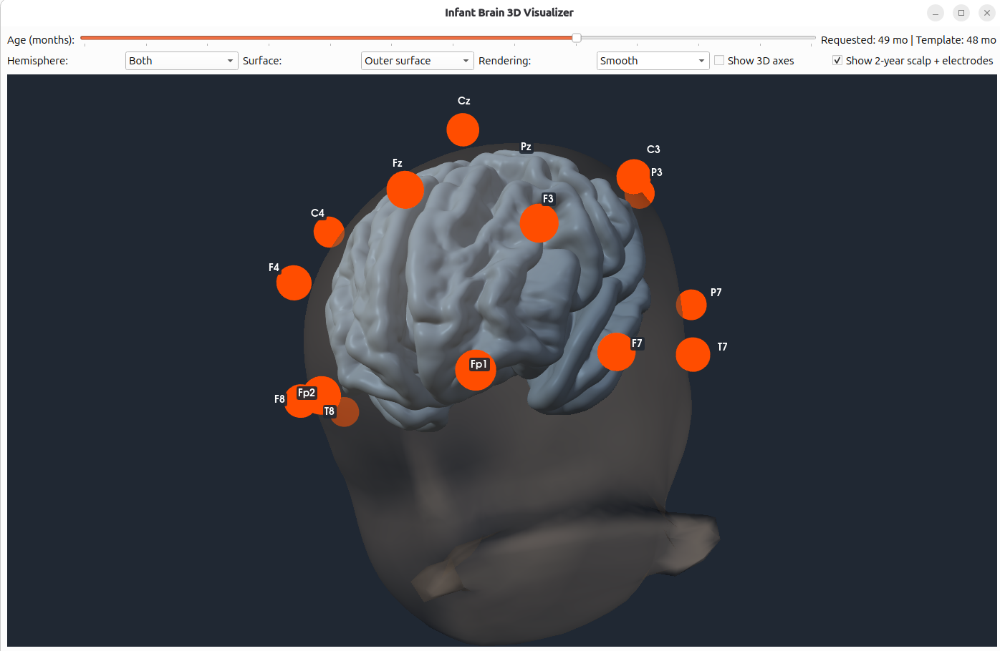
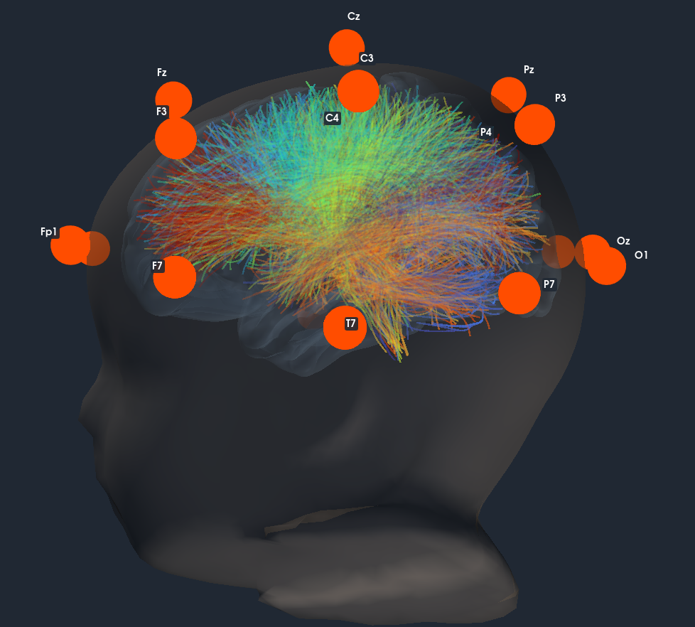

# Infant Brain 3D Visualizer

A Python desktop application for visualizing infant brain surfaces from 1 to 72 months (at 3-month intervalls), scalp and EEG electrode positions, and brain tractography, LORETA scores, connectome, effective connectivity, in a shared 3D view. The viewer supports age-specific infant templates and can optionally compute and display effective connectivity from EEG recordings.

## Features

- Interactive 3D visualization of cortical surfaces and tractography.
- Infant scalp and skull geometry with EEG electrode locations.
- Age/template selection for infant head geometry.
- Overlay of electrodes and tractography for spatial inspection.
- Optional effective-connectivity analysis using **Granger causality** or **transfer entropy** from EEG data.
- Loading of local atlas and surface files from the repository.
- It can perform quality check and pre-processing of .edf files
- Canonical views as axial, sagittal, coronal and automatic saving of the scene.

## Instructions
- Most of the commands are as radio button on top. The Loreta and effective connectivity analysis expect to load a .edf file
- The view settings and saving options are in the menu at the bottom of the GUI.

Alternatively, most of the commands can be called by command line scripts which are indepdent from the GUI program:
### Quality check: saves <name>_quality.txt (and/or .json) next to the input or in -o
python edf_quality_cli.py rec.edf -o reports/ --format both --fail-on-warn

### Preprocessing from a config file
python edf_preprocess_cli.py --write-default-config > preproc.json

python edf_preprocess_cli.py data/*.edf -c preproc.json -o out/ --overwrite

python edf_preprocess_cli.py rec.edf -c preproc.json --set lowpass=45 --set resample=true --set resample_hz=125

### Connectomes, saved as CSV
python edf_granger_cli.py rec.edf -o out/ --lag 5 --edge-list

python edf_transfer_entropy_cli.py rec.edf -o out/ --bins 4 --lag 1 

### Loreta given different surfaces
python edf_loreta_cli.py rec.edf --age 12 -o out/

python edf_loreta_cli.py data/*.edf --age 6 --surface inflated --screenshot --overwrite

python edf_loreta_cli.py rec.edf --age 12 --no-surface      # tables and JSON only
  
## Screenshots

### EEG electrode locations

The scalp and EEG electrode positions are shown in 3D.



### Brain tractography and electrode overlay

Example screenshot showing the brain tractography together with the EEG electrode overlay.


 
## Repository files

- `infant_connect.py` — main interactive 3D viewer and application entry point.
- `effconn.py` — standalone effective-connectivity implementation (optional alternative to installing `effconnpy`).
- `requirements.txt` — Python dependencies for the viewer.
   
- `generate_cortex.py` — prepares/generates the cortical surface files used by the viewer.
- `fetch_tract_atlas.py` — fetches the tractography atlas used for the tract overlay.
- `atlas.json` — atlas manifest/configuration used by the viewer.
- `tract_atlases/` — directory for tractography atlas data.
- `data/` — directory for cortex surfaces.
- `mne_templates/` — directory for skull and EEG electrodes templates.


The cortical surfaces should be prepared with `generate_cortex.py`, and the tractography atlas should be retrieved with `fetch_tract_atlas.py` before launching the viewer. The scalp, skull, and electrode/montage template data are downloaded automatically by the viewer the first time when needed and cached locally.

## Requirements

- Python 3.10 or newer is recommended.
- A desktop environment capable of running Qt and rendering VTK/PyVista 3D scenes.
- Python packages listed in `requirements.txt`.

## Installation

Clone the repository and enter its directory:

```bash
git clone https://github.com/alecrimi/infantconnect.git
cd infantconnect
```

Create and activate a virtual environment (recommended):

```bash
python -m venv .venv
source .venv/bin/activate
```

On Windows, activate it with:

```powershell
.venv\Scripts\Activate.ps1
```

Install the dependencies:

```bash
python -m pip install --upgrade pip
python -m pip install -r requirements.txt
```

## Prepare the data

Run the preparation scripts from the repository root:

```bash
python generate_cortex.py
python fetch_tract_atlas.py
```

These scripts prepare the cortical surfaces and fetch the tractography atlas, respectively. Check their console output for any download or preparation errors. Make sure the resulting files are placed where the viewer expects them, and that `atlas.json` and `tract_atlases/` are present.

The viewer downloads the required infant scalp, skull, and electrode/montage template data on demand. An internet connection is needed the first time each template is requested. Downloaded template files are cached locally for later runs.

## Run the viewer

From the repository root, run:

```bash
python infant_connect.py
```

Run the command from the repository root after completing the preparation steps above.

Use the viewer controls to toggle the scalp/electrodes, cortical surfaces, and tractography layers. Available controls and displayed options may depend on the atlas and surface files that have been prepared.

## Effective connectivity

The viewer can compute and display effective connectivity from an EEG recording using **Granger causality**, **transfer entropy** and other methods.

There are two ways to provide the implementation:

1. **Install `effconnpy`** from [piwheels](https://www.piwheels.org/project/effconnpy/):

   ```bash
   python -m pip install effconnpy
   ```

   The installed package must expose `compute_effective_connectivity` from the `effconn` module, as expected by the viewer.

2. **Use the standalone implementation** included in this repository as `effconn.py`. Keep `effconn.py` alongside the main viewer script so that `from effconn import compute_effective_connectivity` can resolve locally. If you choose this option, you generally do not need to install a separate package providing the same module.

To run the analysis, load an EEG recording through the viewer and enable the effective-connectivity control. The available methods are Granger causality and transfer entropy. The recording's channel names need to correspond to the electrode labels supported by the selected montage/template for the electrode positions to be fitted correctly.

## Data and attribution

The project integrates three publicly available neuroimaging resources:

- **[NABA800FC tractography atlas](https://zenodo.org/records/18227691)** — a cross-population white-matter tractography atlas for neonates and adults. The dataset is distributed under the [Creative Commons Attribution 4.0 International (CC BY 4.0) licence](https://creativecommons.org/licenses/by/4.0/).

- **[MNE infant head/skull surface templates](https://github.com/christian-oreilly/infant_template_paper)** — infant head and skull surface templates used for EEG electrode visualisation and anatomical modelling.

- **[4D UNC Neonatal and Infant Cortical Surface Atlases](https://www.nitrc.org/projects/infantsurfatlas/)** — age-specific neonatal and infant cortical surfaces, provided in VTK format for 3D brain visualisation.

Use EEG data from Openneuro to test.

## Troubleshooting

- **Missing surface or atlas files:** run `generate_cortex.py` and `fetch_tract_atlas.py` from the repository root and check their output.
- **Missing Python module:** activate the intended environment and reinstall dependencies with `python -m pip install -r requirements.txt`.
- **Qt/VTK display problems:** run the viewer in a desktop session with working graphics support; headless environments may not support the interactive window.
- **Effective-connectivity import error:** ensure either the repository's `effconn.py` is alongside the viewer or the compatible `effconnpy` package is installed.
- **Electrodes do not align with the recording:** check the EEG channel names and the montage/template selected in the viewer.

## Citation

If you use this software in research, please cite this repository [10.5281/zenodo.23506486](https://zenodo.org/records/23506486)

## Licence

Copyright 2026 Alessandro Crimi

Licensed under the Apache License, Version 2.0 (the "License");
you may not use this file except in compliance with the License.
You may obtain a copy of the License at

    https://www.apache.org/licenses/LICENSE-2.0

Unless required by applicable law or agreed to in writing, software
distributed under the License is distributed on an "AS IS" BASIS,
WITHOUT WARRANTIES OR CONDITIONS OF ANY KIND, either express or implied.
See the License for the specific language governing permissions and
limitations under the License.
If you intend to release your own code under a permissive licence such as MIT, add the corresponding `LICENSE` file and confirm that this is compatible with all code you authored and redistributed. The licence for this repository does not automatically relicense external datasets or assets.
